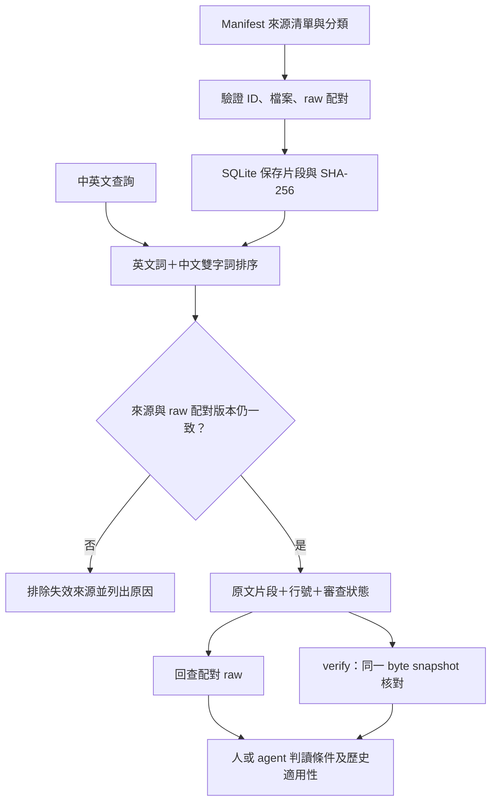
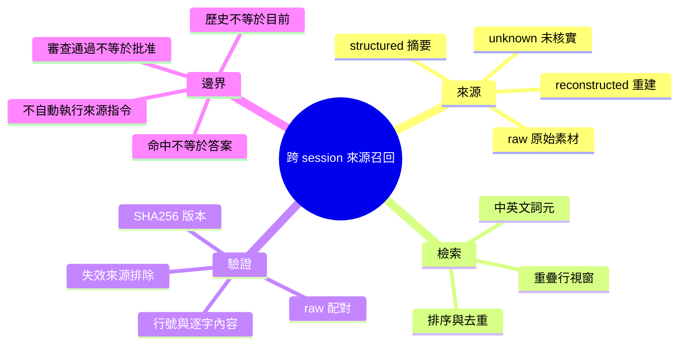

# Context Recall Lab｜跨對話來源召回

在新 session 找回過去討論，交付帶行號、版本指紋及來源類別的**證據包**，供人或 agent 回查。Python 標準函式庫即可執行，不需要 API key。

例如：舊摘要寫「部署已否決」，對話卻說「先凍結，等成本確認」。本專案會保留摘要的 `unresolved` 標記、指出配對 raw，讓讀者查回原文；不把摘要的存在當成使用者已批准。

**v0.1：本機詞彙檢索與引用驗證。** 已有可重跑 CLI、JSON／HTML 證據包、合成案例與測試。它不生成答案，也不自動判斷哪個歷史決策現在仍有效。

## 問題與研究目標

長期 agent 協作累積了原始對話、結構化摘要與審查紀錄。只讀摘要會失去條件；只靠關鍵字找到檔案，又容易引用錯版本、把提案當決策、把模型重建文字當逐字紀錄。

本專案檢查三件事：

1. 能否從中英文查詢找回相關片段，並保留原文行號？
2. 當檔案變動、引用遭修改或摘要未解決時，系統是否呈現正確狀態？
3. 哪些是機械可驗證的引用一致性，哪些仍需要人或 reviewer 判斷？

源於既有 context-save → structured review → context-publish → context-recall 方法。這一版新增可攜本機檢索及驗證層；原本的 NotebookLM 召回仍是另一條工作路徑。來源方法及本次新增工作見[設計與方法](docs/design.md)。

## 五分鐘重跑

環境：Python 3.10+，僅使用標準函式庫；本次實測 macOS／Python 3.13。從 repository 根目錄執行：

```bash
python3 recall.py build examples/manifest.json runs/demo/index.sqlite
python3 recall.py search runs/demo/index.sqlite '部署 凍結 預算' --out runs/demo/evidence.json --html runs/demo/evidence.html
python3 recall.py verify runs/demo/index.sqlite runs/demo/evidence.json
python3 evaluate.py
python3 -m unittest discover -s tests -v
```

打開 `runs/demo/evidence.html` 查看結果。範例是刻意編寫的合成對話，包含錯誤摘要；不是客戶案例或真實使用者原話。所有輸出採新路徑，重跑請用 `runs/demo-v2/`，避免覆寫來源或舊證據。

從摘要追到原始對話：

```bash
python3 recall.py search runs/demo/index.sqlite '部署' --kind structured
python3 recall.py search runs/demo/index.sqlite '部署' --source session-a-raw
```

`raw_parent` 是文件配對，不代表摘要每句已有 raw 支持。`verify` 通過僅表示引用內容、行號、metadata 和當次讀取的來源版本一致，**不表示文字內容正確或使用者批准**。

## 流程圖



## 心智圖



## 技術棧

| English | 中文 | 在此專案的作用 |
|---|---|---|
| Python CLI | 命令列程式 | 建索引、搜尋、驗證、匯入 |
| SQLite | 本機關聯式資料庫 | 保存來源 metadata、片段與詞元；查詢目前由 Python 全掃描 |
| CJK bigrams | 中文連續雙字詞 | 不安裝分詞模型的中文詞彙基線 |
| IDF-weighted overlap | 依詞彙稀有度加權的重疊排序 | 排序候選；不是 BM25、向量相似度或信心值 |
| SHA-256 | 內容指紋 | 綁定來源版本，檢出變動 |
| Atomic exclusive publication | 原子排他發布 | 不覆蓋既有索引或 JSON 產物 |
| HTML / JSON | 閱讀頁面／結構化介面 | 同一證據包供人與 agent 使用 |
| unittest | 自動測試 | 驗證竄改、缺檔、失效來源與檔案保護 |

## 目前結果

- 25 項程式測試通過；5 題合成驗收可用 `evaluate.py` 重跑。
- 本機歷史資料：29 組 raw／structured、58 份文件、557 個片段。
- 5 題歷史查詢，預先指定來源有 3 題進前五名；1 題無資料查詢沒有命中。這是開發診斷，不是準確率基準。
- 25 個回傳片段的引用一致性檢查通過。其中一題預期來源後來發現標錯分段；保留原始失敗，不回填漂亮分數。
- 獨立 reviewer 發現覆寫與兩次讀檔競爭問題，已修正並加入回歸測試。

完整背景、材料與方法、結果及限制：[實驗報告](docs/experiment-2026-10-08.md)。

## 匯入自己的紀錄

已有 `raw/*.raw.md`、`structured/*.structured.md`，可執行：

```bash
python3 import_context.py /path/to/context_log runs/my-context
python3 recall.py search runs/my-context/index.sqlite '要找的詞' --kind raw
```

匯入器以共同檔名前綴配對，讀取選用的 `metrics.jsonl`。無法驗證轉錄真實性的 raw 一律標 `unknown`；`pass`／`unresolved` 只保存歷史宣告，不保證對應目前檔案。孤立摘要會列出、不加入索引。

私人來源、索引及搜尋輸出放在 Git 忽略的 `runs/`；HTML／JSON 可能含私人原文，分享前需自行檢查。程式不連網、不上傳 NotebookLM、不修改正式 wiki。

## 適用範圍與下一步

目前適合小型、可讀取完整檔案的本機資料集。每次搜尋會檢查全庫檔案 hash，並全掃描片段；沒有大資料量效能驗證。中文同義詞、跨語言問題與語意改寫仍可能漏召回，通用詞也可能回傳不相關片段。

下一個可衡量的工作是建立獨立標註的查詢集，再比較此詞彙基線與向量／混合檢索。先量測錯在哪裡，再決定要加什麼。來源內容即使含指令，也只能作為資料；下游 agent 仍需自己的指令邊界，程式沒有聲稱消除 prompt injection。

Author: Nio (Master) · Implementation: Codex · 2026-10-08
