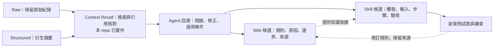
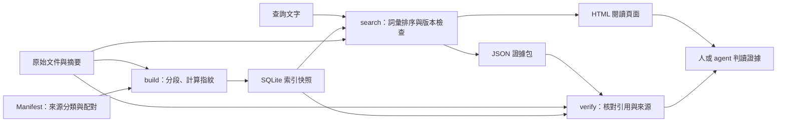
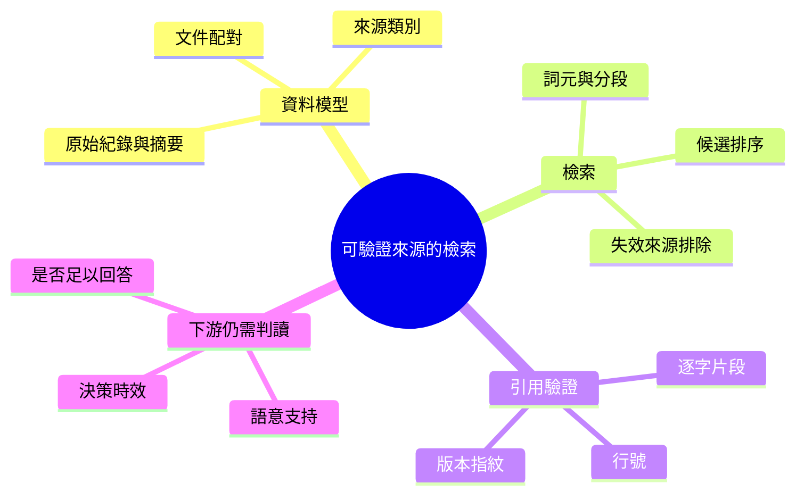

# Context Recall｜從協作紀錄找回可重用的工作方法

為 agent 檢索歷史文件時，同時交付**原文片段、引用位置、來源版本與摘要的原始出處**。讓下游使用者可以回查「這句話從哪裡來、引用的檔案是否已經改過」。

適用於對話紀錄、研究筆記等小型本機資料集。提供 Python CLI、JSON 與 HTML 輸出，僅使用標準函式庫，無須模型 API。**目前版本：詞彙檢索與引用驗證元件。**

## 這些紀錄最後用來做什麼？

保留協作紀錄，是為了讓 agent 能回溯「問題怎麼發現、為什麼改變做法」，進一步整理為 Wiki 知識，或提煉為可重複執行的 skill。**本 repo 提供其中的來源檢索與引用核對基底；知識整理與 skill 設計由下游 agent 完成。**



Wiki 與 skill 可以由同一組紀錄分別提煉，不必強制先後。Wiki 回答「為什麼、何時適用」；skill 回答「遇到這類任務怎麼執行」。兩者都需保留原始依據。

**歷史案例：固定化對話提取。** Nio 在 2026-04-22 提出 raw／structured 分開保存，讓未來能將運作方法提取成 skill 或 subagent，並要求固定提取流程。Claude 隨後建立六段 schema 的 `context-extract` 原型。這證明需求曾落成操作規格；尚不能證明提取結果穩定，也沒有證據支持「已經自動產生可靠 skill」。[案例、現況與缺口](docs/knowledge-pipeline.md)

## 實作示範：從歷史失敗形成審查方法

[主張強度審查案例](examples/claim-strength/README.md)串起實際檢索、引用核對、Wiki／skill 候選與新案例獨立試跑。清楚區分程式取回證據、agent 提煉，以及尚未證明的方法效果。

## 為什麼需要這個元件？

把搜尋結果交給 agent 之前，有三個不同的問題需要處理：

| 問題 | 例子 | 本專案的處理 |
|---|---|---|
| 文件層級混淆 | 摘要寫「方案否決」，原始對話寫「等待成本確認」 | 區分原始紀錄與摘要，保留配對關係與已知審查狀態，供回查 |
| 引用版本失效 | 索引建立後，原始檔案又被修改 | 搜尋時比對內容指紋，排除已變動來源及其配對摘要 |
| 引用無法重現 | 答案附檔名，卻找不到所引句子 | 回傳行號、逐字片段及指紋，提供獨立核對命令 |

這些資訊補足了「找到相關文字」之後的交付環節。**語意是否正確、歷史決策是否仍有效，仍需人或下游 agent 判讀。** 本工具不自動生成答案或更新長期記憶。

## 一個完整例子：部署是凍結，還是否決？

Repository 內附三份合成文件。以下兩份刻意包含原文與錯誤摘要，用來展示來源資訊如何幫助回查：

| 輸入文件 | 內容節錄 | 清單中預先提供的狀態 |
|---|---|---|
| [原始對話](examples/raw/session-a.md) | 「部署方案先凍結，等成本確認後再決定；這不是否決。」 | `kind: raw` |
| [衍生摘要](examples/structured/session-a.md) | 「部署方案已被否決，每月成交價格為 800 元。」 | `kind: structured`、`review: unresolved` |

查詢 `部署 凍結 預算` 後，工具返回兩份文件的片段。主要欄位如下；完整輸出由下方命令產生：

| 輸出欄位 | 原始對話命中 | 摘要命中 | 用途 |
|---|---|---|---|
| `id` | `session-a-raw` | `session-a-structured` | 識別來源 |
| `start_line` / `end_line` | 1–9 | 1–6 | 定位逐字片段 |
| `review` | `unknown` | `unresolved` | 保留清單中的狀態 |
| `raw_parent.id` | 無 | `session-a-raw` | 從摘要找回原始文件 |
| `sha256` | 原始檔案指紋 | 摘要檔案指紋 | 核對是否仍為同一版 |

這裡的 `unresolved` **由範例清單提供，並非工具辨識出摘要錯誤**。讀者可依 `raw_parent` 查回原文，辨認「凍結」被改寫成「否決」；程式負責保存及核對引用，不替讀者做這項語意判斷。

### 執行範例

需要 Python 3.10+；本版實測環境為 macOS／Python 3.13。在 repository 根目錄執行：

```bash
python3 recall.py build examples/manifest.json runs/demo/index.sqlite
python3 recall.py search runs/demo/index.sqlite '部署 凍結 預算' --out runs/demo/evidence.json --html runs/demo/evidence.html
python3 recall.py verify runs/demo/index.sqlite runs/demo/evidence.json
```

第三個命令的結果：

```json
{"valid": true, "checked": 2, "issues": []}
```

`valid` 表示這兩筆引用與來源檔案、行號及登錄資訊一致。錯誤摘要也可以通過引用核對，因為「忠實引用錯誤文字」與「文字本身正確」是不同問題。

打開 `runs/demo/evidence.html` 可閱讀結果。需要只查配對原文時：

```bash
python3 recall.py search runs/demo/index.sqlite '部署' --source session-a-raw
```

若之後修改原始對話，再搜尋會排除該原文及其配對摘要；舊證據包的 `verify` 也會失敗。要重新建立索引，請使用新路徑，例如 `runs/demo-v2/`，保留舊版本供比對。

## 架構：建立索引 → 取回片段 → 核對引用



`build` 保存最多 20 行、步長 12 行的重疊片段；`search` 依英文詞與中文雙字詞的加權交集排序，抑制同文件的重疊命中。每次搜尋重新核對檔案指紋；`verify` 用同一份讀入的 bytes 檢查指紋與引文，避免不同版本被混用。

| 設計選擇 | 解決的問題 | 代價 |
|---|---|---|
| 原始紀錄與摘要分開登錄 | 保留衍生關係，方便回查 | 配對需正確提供，不保證逐句語意支持 |
| 詞彙檢索作為基線 | 免模型依賴，排序可檢查 | 同義詞、跨語言查詢容易漏失 |
| 每次搜尋重新計算來源指紋 | 發現索引建立後的檔案變動 | 每次都需讀取全庫文件 |
| 新索引寫入新路徑 | 避免覆蓋來源或舊證據 | 舊版本需自行管理 |

演算法、資料契約及失敗行為詳見[技術設計](docs/design.md)。

## 驗證結果與適用範圍

| 驗證層 | 已有證據 | 能支持的結論 |
|---|---|---|
| 程式行為 | 25 項測試通過，含引用竄改、來源變動、寫入保護及狀態衝突 | 這些受測條件有對應處理 |
| 可重跑示例 | 5 題合成查詢通過 | 範例流程可執行 |
| 引用一致性 | 歷史資料回傳的 25 個片段皆通過核對 | 引用與當時檔案內容一致 |
| 檢索相關性 | 5 題診斷中，3 題命中原先指定來源；另發現 1 題標註錯誤 | 尚不足以估計召回品質 |

測試資料規模為 58 份歷史文件、557 個片段。尚無獨立人工標註集、agent 接手成效或大資料量效能結果。程式目前全掃描片段；適合先驗證小型本機資料的引用流程。

```bash
python3 evaluate.py
python3 -m unittest discover -s tests -v
```

[實驗報告](docs/experiment-2026-10-08.md)保留研究方法、失敗分析與結果限制；[結果 JSON](docs/results-2026-10-08.json)提供數值紀錄。

## 技術棧與能力範圍

| English | 中文 | 實際用途 |
|---|---|---|
| Python CLI | 命令列介面 | 匯入、建索引、搜尋與引用驗證 |
| SQLite | 本機資料庫 | 保存片段及來源 metadata，排序由 Python 執行 |
| CJK bigrams | 中文雙字詞 | 建立無分詞模型依賴的中文檢索基線 |
| IDF-weighted overlap | 稀有詞加權交集 | 對候選片段排序；分數不代表信心值 |
| SHA-256 | 內容指紋 | 核對來源版本 |
| HTML / JSON | 閱讀頁面／結構化輸出 | 將同一組引用交給人或 agent |



## 使用自己的資料

依 [manifest 範例](examples/manifest.json)登錄文件，或匯入既有 `raw/*.raw.md` 與 `structured/*.structured.md`：

```bash
python3 import_context.py /path/to/context_log runs/my-context
python3 recall.py search runs/my-context/index.sqlite '要找的詞' --kind raw
```

匯入器以共同檔名前綴配對。來源真實性無法確認時標為 `unknown`；歷史審查與文件狀態衝突時列入 audit。私人索引與輸出保存在 Git 忽略的 `runs/`，可能包含原文，分享前需檢查。

Author: Nio (Master) · Implementation: Codex
