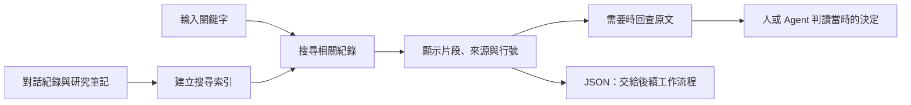
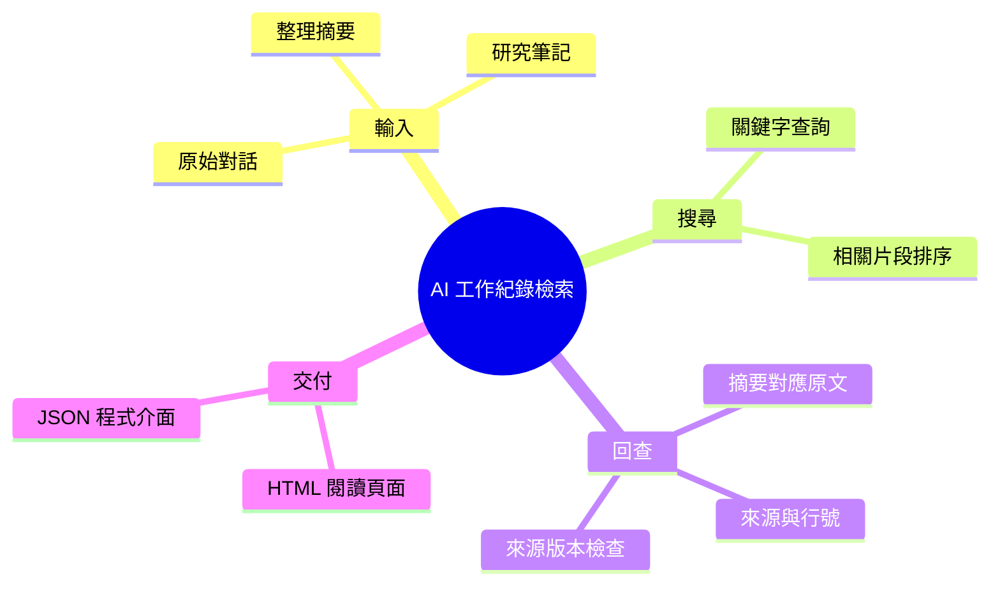

# AI 工作紀錄檢索工具

**輸入關鍵字，從過往對話與研究筆記找回相關原文，查看當時的決定與處理方法。**

供需要回查工作紀錄的人或 AI 助手使用。搜尋結果包含文字片段、來源標記與行號；若命中的是摘要，可用它附帶的原始來源標記再次搜尋原文。

目前提供本機命令列工具，以及 HTML 閱讀頁面和 JSON 輸出。使用關鍵字比對，不需要模型 API；不會自動生成答案。

## 看一次搜尋結果

你想確認：「之前的部署方案，到底是暫停還是取消？」

輸入關鍵字：`部署 凍結 預算`。Repo 內的合成範例會找到：

| 找到的紀錄 | 文字片段 |
|---|---|
| [原始對話](examples/raw/session-a.md) | 部署方案先凍結，等成本確認後再決定；這不是否決。 |
| [整理摘要](examples/structured/session-a.md) | 部署方案已被否決，每月成交價格為 800 元。 |

**回查原文後，可以看出摘要把「暫停」寫成「取消」，也把預算寫成成交價格。** 工具負責把兩份紀錄與命中行號交給你；這項內容判斷由人或讀取結果的 agent 完成。範例中的摘要錯誤是刻意設計的測試資料。

## 核心功能

| 功能 | 使用時得到什麼 |
|---|---|
| 搜尋歷史紀錄 | 依關鍵字排序的相關片段，不必先翻完所有文件 |
| 從摘要回查原文 | 摘要附帶原始來源標記，可再查該來源的文字片段 |
| 檢查來源是否更新 | 排除建索引後已改動的來源及其配對摘要，避免混用版本 |
| 輸出搜尋結果 | HTML 供閱讀，JSON 供 agent 或後續程式取用 |
| 核對已保存的引用 | 檢查片段、行號與來源是否仍一致 |



## 快速開始

需要 Python 3.10+，只使用標準函式庫。下載 repo 後，在根目錄執行：

```sh
python3 recall.py build examples/manifest.json runs/demo/index.sqlite
python3 recall.py search runs/demo/index.sqlite '部署 凍結 預算' --out runs/demo/evidence.json --html runs/demo/evidence.html
python3 recall.py verify runs/demo/index.sqlite runs/demo/evidence.json
```

開啟 `runs/demo/evidence.html`，查看上述兩筆結果及來源。最後一行核對命令預期回傳：

```json
{"valid": true, "checked": 2, "issues": []}
```

若要只看摘要對應的原始紀錄，本例的來源標記是 `session-a-raw`：

```sh
python3 recall.py search runs/demo/index.sqlite '部署' --source session-a-raw
```

來源標記與檔案路徑的對照保存在輸入的文件清單中；結果頁不直接提供檔案路徑或開檔按鈕。

核對通過表示引用與檔案一致，不代表被引用的文字一定正確。重建索引時請改用新的目錄，例如 `runs/demo-v2/`。

## 使用自己的紀錄

依 [文件清單範例](examples/manifest.json)登錄要搜尋的文件，並指定摘要對應哪份原文。若已有 `raw/*.raw.md` 與 `structured/*.structured.md`，可以匯入：

```sh
python3 import_context.py /path/to/context_log runs/my-context
python3 recall.py search runs/my-context/index.sqlite '要找的詞' --kind raw
```

`raw` 保存原始紀錄，`structured` 保存整理摘要。匯入器用共同檔名前綴配對；不會自動理解兩份內容是否相符。輸出可能含私人原文，預設放在 Git 忽略的 `runs/`。

## 進階案例：找回方法，整理成知識與 Skill

搜尋結果也能交給 agent，整理成 AI 知識庫的規則，或可重複使用的任務步驟（Skill）。這是後續的整理工作，不是搜尋工具自動完成的功能。

[從歷史錯誤整理審查方法](examples/claim-strength/README.md)：展示取回紀錄、核對原文、整理規則，再用新案例試跑的過程。[設計背景與限制](docs/knowledge-pipeline.md)

## 架構與技術棧



| 技術 | 中文用途 |
|---|---|
| Python CLI | 執行匯入、搜尋與引用核對 |
| SQLite | 保存可搜尋的文字片段與來源資料 |
| HTML / JSON | 提供閱讀結果與後續程式輸入 |
| unittest | 檢查來源變動、引用竄改與寫入保護等行為 |

分段、排序、版本指紋及輸出欄位詳見[技術設計](docs/design.md)。

## 測試與限制

已有 25 項程式測試，以及可重跑的合成查詢。關鍵字不同、同義詞或跨語言查詢可能找不到；目前適合小型本機資料集。尚未證明能提高 agent 任務成功率，也不是具備向量搜尋或對外 API 的完整服務。

```sh
python3 -m unittest discover -s tests -v
python3 evaluate.py
```

[實驗報告與失敗分析](docs/experiment-2026-10-08.md) · [歷史結果](docs/results-2026-10-08.json)

Author: Nio (Master) · Implementation: Codex
