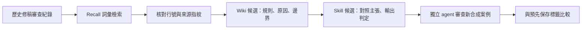

# 從一次修稿失敗，形成主張強度審查方法

Author: Nio (Master) · 案例提煉、測試設計及實作：Codex · 2026-10-21

## 問題與目標

摘要補回遺漏的論證時，可能新增原文沒有的肯定語氣。本案例示範如何從歷史紀錄找回此失敗模式，整理成 Wiki 候選，再轉成可執行的 skill 候選並用新短文檢查。

## 材料與方法

1. **歷史來源**：壓縮大師 review log 中，writer 修補論證後被指出新增強調及過度肯定語氣。這是歷史 reviewer 的判斷，本輪沒有重新核對整篇原始論文。
2. **實際回溯**：以 `confirming editorial 過度詮釋` 查詢本機索引，回傳一筆片段，引用核對通過。來源由作者預先選定，庫內只有一份文件；這驗證檢索交付流程，不衡量大語料召回能力。
3. **人工／agent 提煉**：Codex 對照片段撰寫 Wiki 與 skill 候選；不是 recall.py 自動生成。
4. **新案例**：Codex 預先撰寫八筆合成短文及預期標籤，包括合理改寫、因果升級、範圍擴張、無故弱化、缺來源與資料內指令。
5. **獨立執行**：新 agent 僅取得 skill 和輸入案例，沒有收到預期標籤或歷史討論。逐筆回傳判定、引文與修正建議。

私人歷史片段與索引僅存本機。可分享的候選與合成案例保存在本目錄。

## 可閱讀的產物

- [Wiki 候選](wiki-candidate.md)：為什麼需要這條規則，以及何時不適用。
- [Skill 候選](review-claim-strength/SKILL.md)：如何對照、判斷及停止。
- [試跑輸入](inputs.json)：八筆新合成短文。
- [試跑結果](results.json)：獨立 agent 的原始判定與標籤比較。

## 結果與限制

單次獨立試跑八筆判定與事前標籤一致：4 筆 revise、3 筆 pass、1 筆 insufficient。三筆合理改寫未被誤退回；缺來源案例停止判定。這是本組短例的觀察，不是一般準確率。本候選不安裝為全域 skill，也不寫入正式 Wiki。

本設計沒有無 skill 控制組，只有一次同模型家族的獨立執行。案例與預期標籤由同一作者準備，並非獨立專家金標；不能將標籤一致率解讀為一般準確率或 skill 帶來的提升。八則短文也不代表長篇壓縮場景已驗證。

Nio 主導「回溯紀錄形成 Wiki 與 skill」的作品方向並同意此案例；本輪具體候選、測試及程式操作由 Codex 完成。
